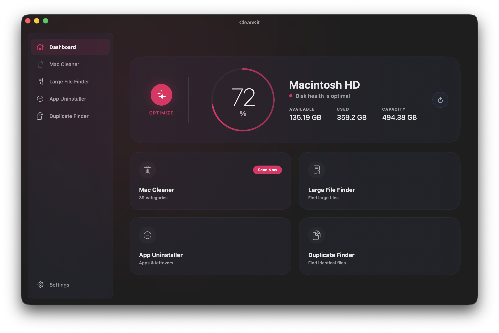
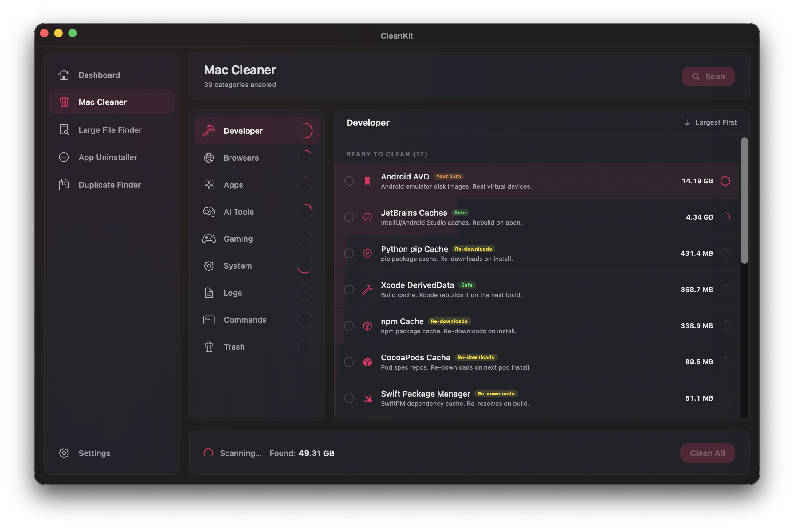
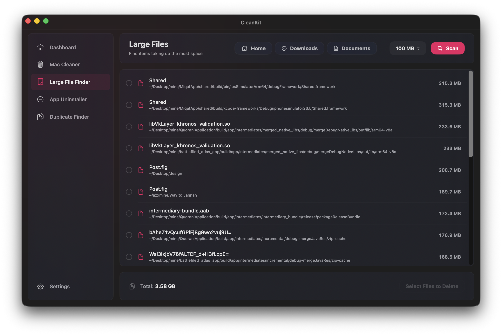
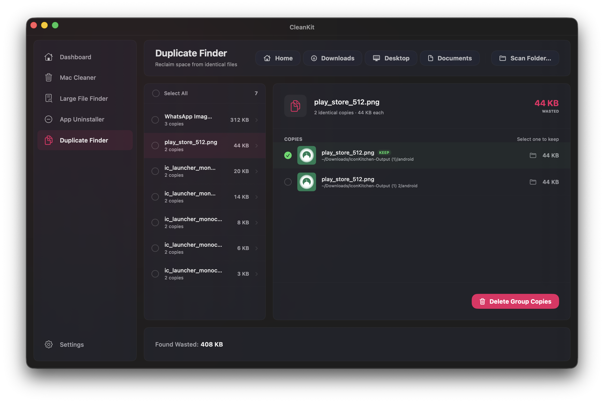
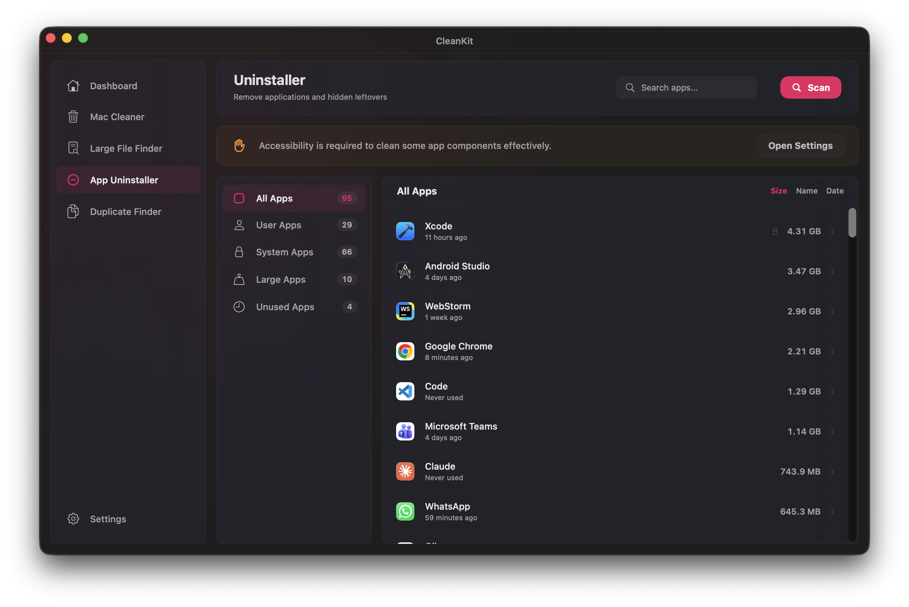
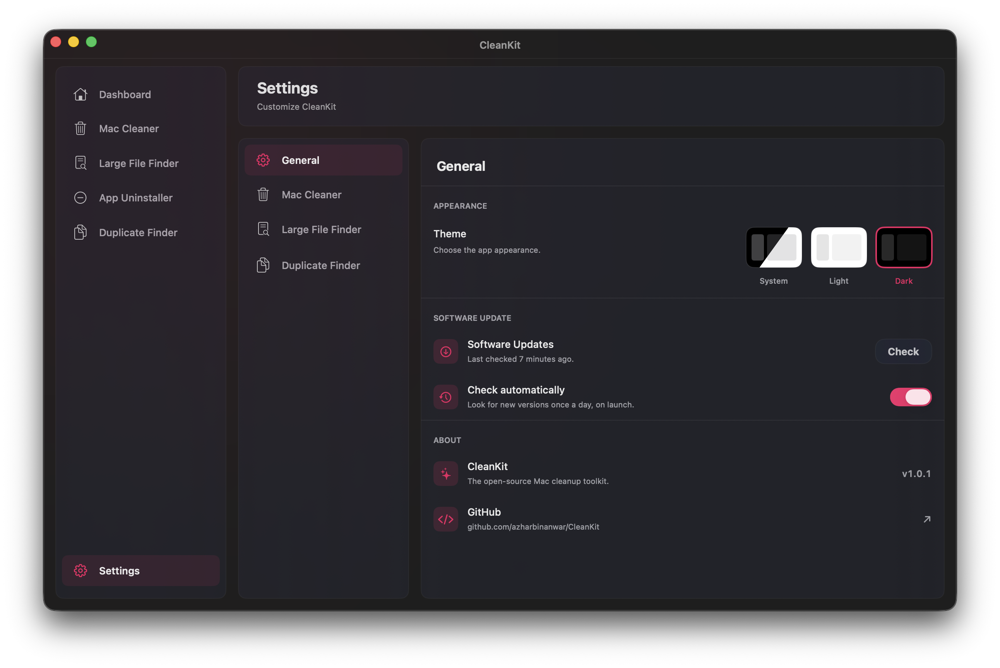
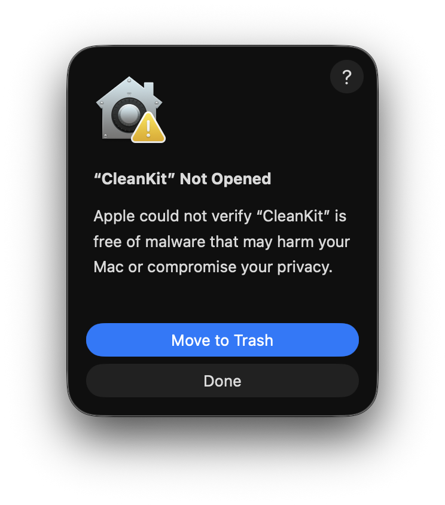
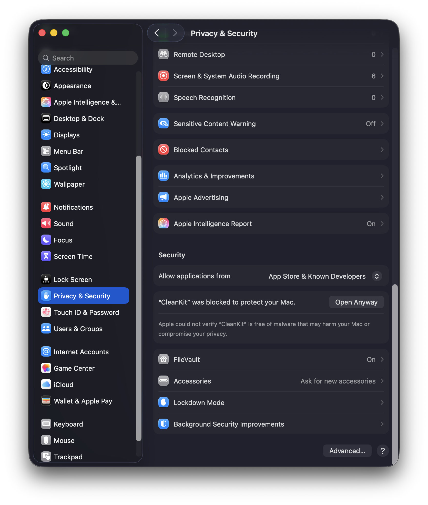
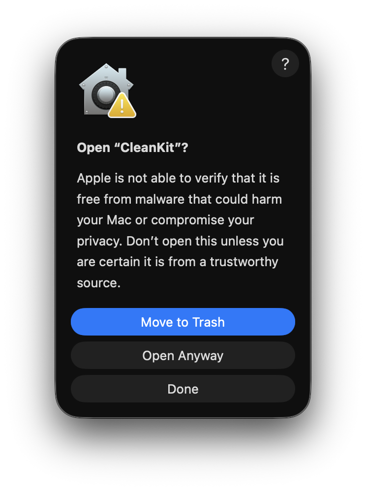

# CleanKit

A free, open-source Mac cleaner and developer toolkit for macOS.



CleanKit helps you reclaim disk space and keep your Mac clean. It scans developer caches, system junk, large files, duplicate files, and leftover app data, all in one place. It measures real disk space before and after a clean, so the amount it frees matches the amount it promised.

## Quick install

One command downloads the latest release, verifies its SHA-256 checksum, installs it to Applications, and launches it. No security dialogs to click through.

```sh
curl -fsSL https://raw.githubusercontent.com/azharbinanwar/CleanKit/main/install.sh | sh
```

Re-run it any time to update. Prefer to drag-and-drop? See [Manual install](#manual-install) below.

---

## Features

### Mac Cleaner
Scan and clean 80+ categories across Developer, Browsers, Apps, AI Tools, Gaming, System, Logs, and Commands. Each category is labeled by how safe it is to remove, and only the ones that exist on your Mac are shown.



### Large File Finder
Find files taking up the most space. Filter by type, sort by size, and delete with one click.



### Duplicate Finder
3-pass content hashing to find exact duplicates. Choose what to keep, and the rest gets deleted.



### App Uninstaller
Remove apps along with their leftover preference files, caches, and support data.



### Settings
Control which categories appear, set large file thresholds, configure duplicate scan limits, and switch between Light, Dark, or System theme.



---

## Install

The fastest way is the one-line [Quick install](#quick-install) at the top. CleanKit also checks for updates on its own and can update itself from **Settings > General**. To install by hand instead:

### Manual install

1. Download `CleanKit.dmg` from [Releases](https://github.com/azharbinanwar/CleanKit/releases)
2. Open the DMG and drag **CleanKit** to your Applications folder
3. Launch CleanKit from Applications

#### First Launch: Security Warning

CleanKit is open source and not notarized, so macOS shows security dialogs the first time you open it after a manual install. Here is exactly what to do. (The Terminal install above avoids this.)

**Step 1.** Double-click CleanKit. macOS blocks it and shows this dialog.



Click **Done** (do not click Move to Trash).

**Step 2.** Open **System Settings → Privacy & Security**. Scroll down and you'll see a message that CleanKit was blocked.



Click **Open Anyway**.

**Step 3.** A final confirmation dialog appears.



Click **Open Anyway**. CleanKit will launch.

> You only need to do this once. After that, CleanKit opens normally.

---

## Build from Source

```bash
git clone https://github.com/azharbinanwar/CleanKit.git
cd CleanKit
open CleanKit.xcodeproj
```

Requires Xcode 16+ and macOS 15.0+.

---

## License

MIT. See [LICENSE](LICENSE)

---

Made by [KodeElite](https://kodeelite.com)
